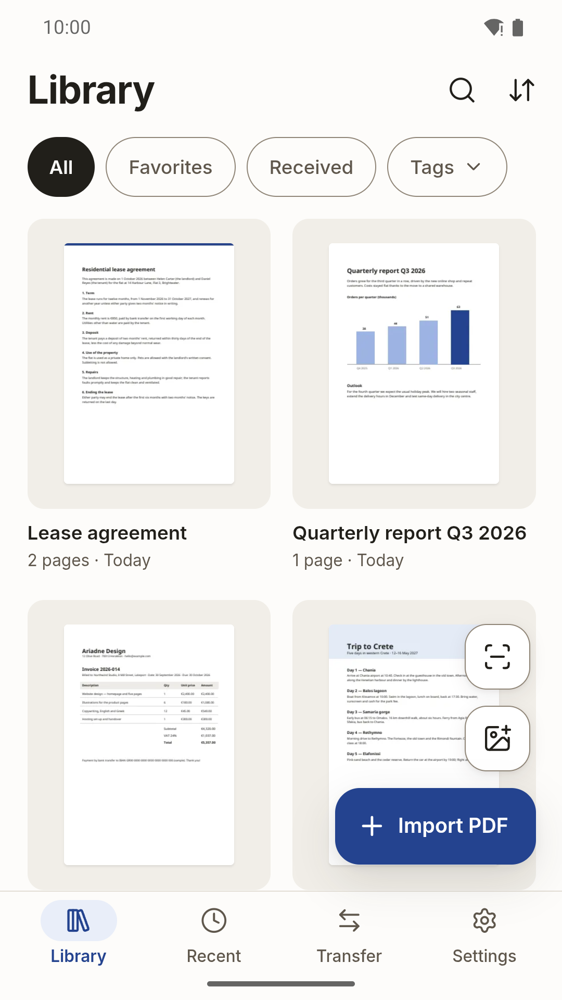
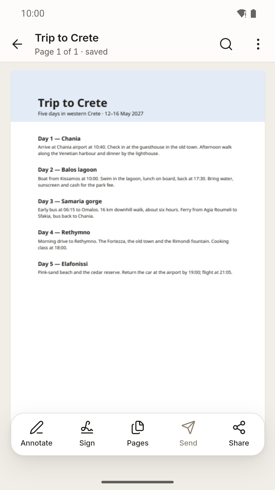
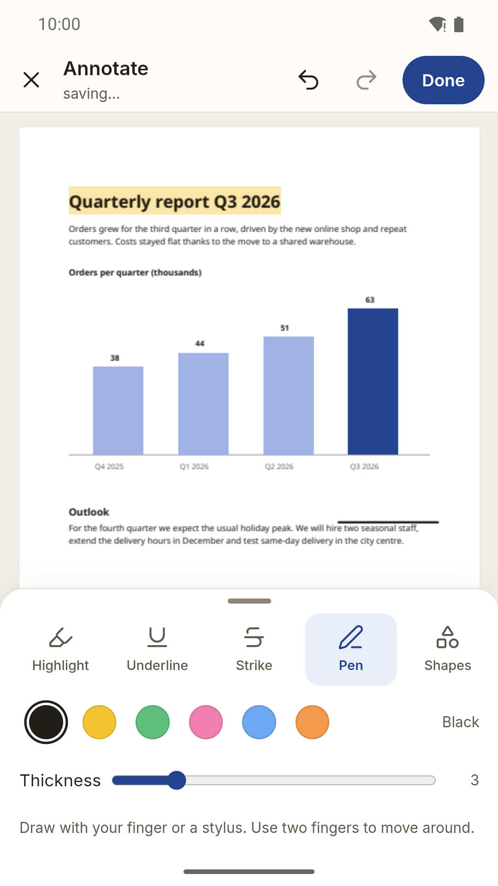
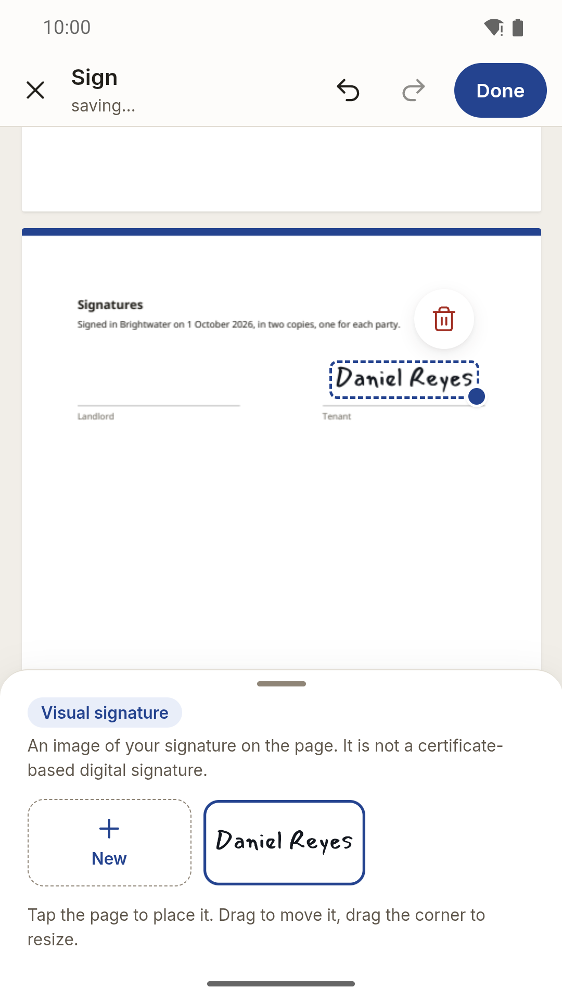
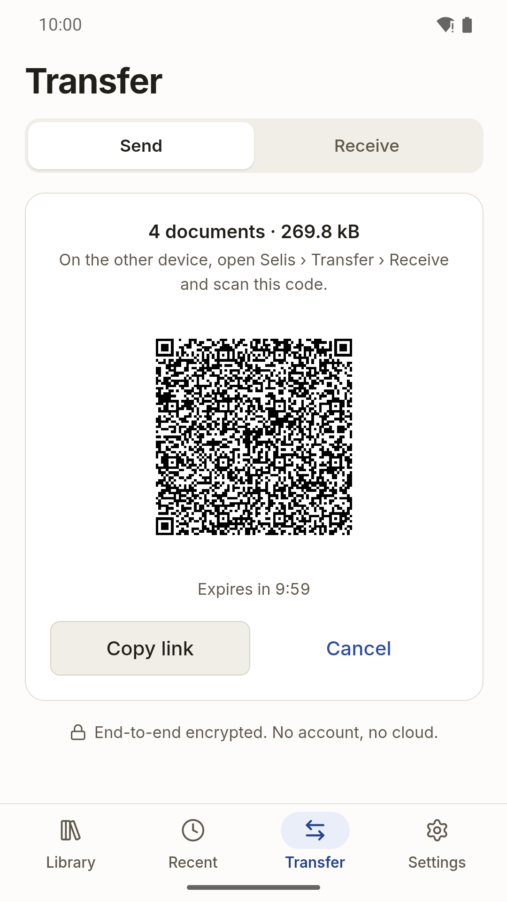
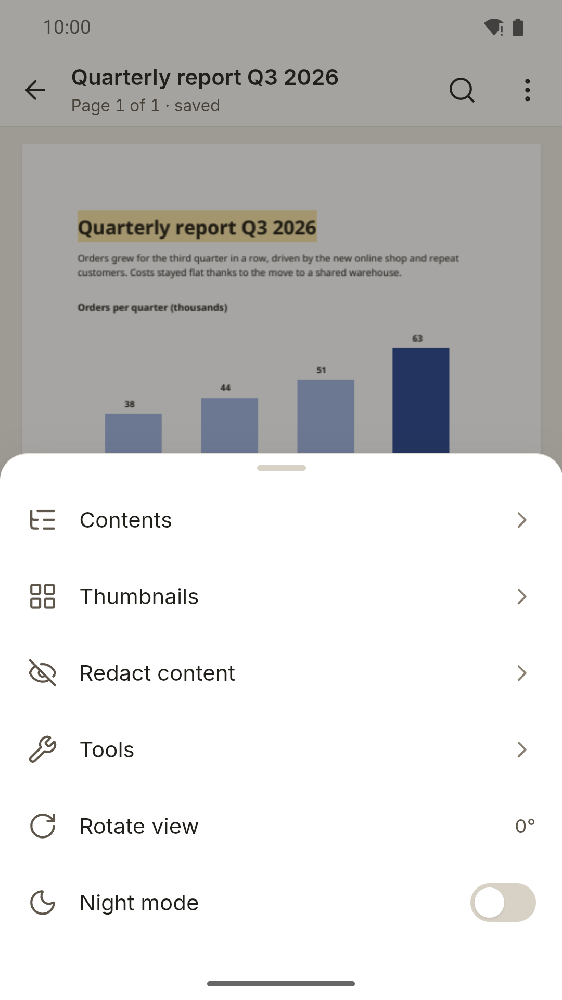
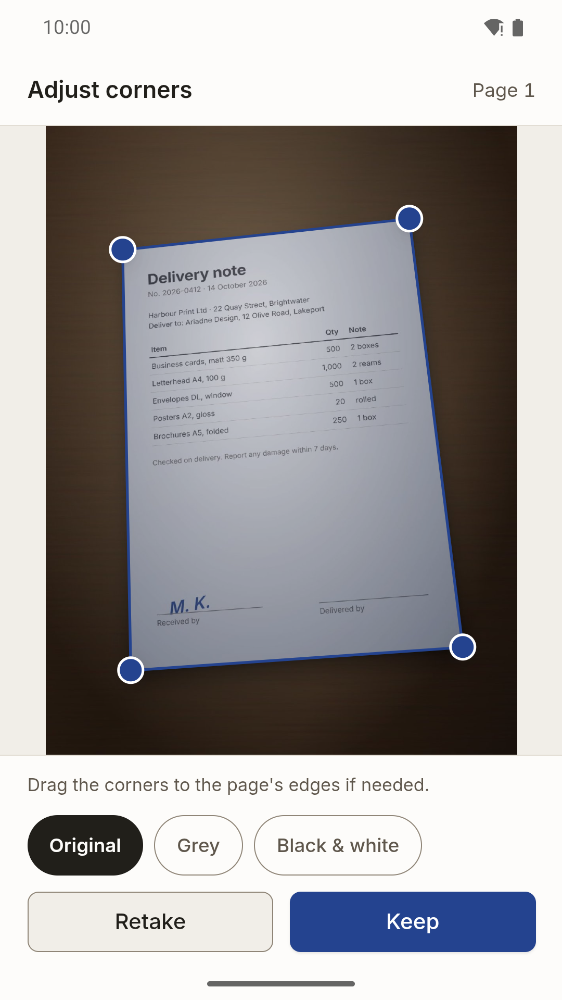

<p align="center">
  
</p>

<h1 align="center">Selis</h1>

<p align="center">A free, open-source PDF editor for Android, iOS, Windows, macOS and Linux — your documents never leave your device.</p>

<p align="center"><strong>No ads · No tracking · No account · No cloud</strong></p>

<!--
  Store badges (App Store, Google Play, F-Droid, Obtainium, GitHub Releases, winget,
  Microsoft Store) and the Exodus Privacy badge go here once real listings exist.
  Official artwork lives in docs/badges/. Do not add placeholder links.
-->

> **Status:** release candidate 1.0 — not yet in the stores.

Developed with AI assistance (Claude Code); every change is reviewed and tested by the maintainer.

## Features

- **Library** on the device: imports are copies, the original file is never modified; search,
  favorites, tags, versions you can go back to.
- **Viewer** for large documents (1000+ pages), search in the text, night mode.
- **Annotate**: highlight, underline, strike, pen, shapes, text and notes.
- **Sign and fill forms**: draw, type or pick a picture of your signature; fill AcroForm fields.
- **Pages**: reorder, rotate, delete, insert, extract.
- **Redact** for real: the text under a box is removed from the file, not just covered.
- **Tools**: password protection, make the file smaller, optimise, repair, save a page as an image.
- **Scan** paper with the camera (or from a photo): captures by itself when the page is steady
  and sharp, an Enhance filter that removes shadows, many pages in one go (reorder, rotate,
  retake, touch up a mark), ID cards front and back on one A4 page; photos to PDF, and **OCR**
  that makes scans searchable — all on the device.
- **Transfer** to your other device without an account, or as a `.selispack` file (below).
- English and Greek, light / dark / sepia themes.

## Screenshots

<p>
  
  
  
  
</p>
<p>
  
  
  
</p>

## Install

Selis 1.0 is distributed through **Google Play** and **GitHub Releases** (signed APKs); the App
Store follows. Android needs version 8.0 or newer with **Android System WebView 111** or newer
(updated through Google Play); on an older WebView Selis shows an "Update Android System WebView"
screen ([ADR 0031](docs/adr/0031-webview-minimum-and-fgs-below-android-14.md)). Not yet in F-Droid (see [docs/store/fdroid/README.md](docs/store/fdroid/README.md)).

**GitHub Releases:** every release has one signed APK per ABI and a universal APK, named
`selis-<version>-<abi>.apk` (`arm64-v8a` for nearly every phone; also `armeabi-v7a`, `x86`,
`x86_64`, `universal`), with a `SHA256SUMS` file. The APK signing certificate's SHA-256 is
published on the [download page](https://fiouri.github.io/selis/download/).

**Updates with [Obtainium](https://github.com/ImranR98/Obtainium):**

1. Obtainium › Add app › App source URL: `https://github.com/Fiouri/selis`.
2. Additional options › **Filter APKs by regular expression**: `arm64-v8a\.apk$` (or the ABI of
   your device, or `universal\.apk$`). Asset names keep this pattern from release to release.
3. Optional: **Include prereleases** to get release candidates (`1.0.0-rc.N`) too.
4. Add, then Install. Obtainium checks GitHub for new releases and installs updates signed with the
   same key; Play and GitHub installs use the same app signing key, so you can switch between
   them without reinstalling.

## Transfer (device to device, no account)

Send documents straight to your other device:

1. **Send** tab: choose documents (optionally with their version history) → a QR code and a
   `selis://transfer/…` link appear (valid once, for 10 minutes).
2. On the other device, **Receive** tab: scan the code (or paste the link; the system camera app
   can open the link too).
3. Both screens show the same 6-digit code. The sender confirms only if it matches.
4. The documents arrive verified (BLAKE3) in the other library, labelled "received". An
   interrupted transfer resumes where it stopped, even after the app was closed.

After a transfer you can **save the device**: next time it is one tap (no QR code) while the
other device has its Receive tab open. **Move whole library** (Send tab) sends everything —
documents with versions, tags, favorites, signatures and settings — to a new phone; documents it
already has are skipped, so running it again changes nothing.

No network at all? **Save as file…** (Send tab) puts the chosen documents — or the whole library —
into one `.selispack` file, optionally protected with a passphrase, for USB, e-mail or your own
cloud. Open it with Selis ("Open with", or Receive › **Open a .selispack file**); a damaged,
truncated or altered file adds nothing ([ADR 0012](docs/adr/0012-selispack.md)).

Devices connect directly when they can (same Wi‑Fi, or across networks), otherwise through an
encrypted relay. Settings › Transfer: **Local network only** (no relay, no address lookup) or your
own **relay**. Nothing touches the network until you open the Transfer screen. Details:
[docs/PRIVACY.md](docs/PRIVACY.md), protocol: [ADR 0010](docs/adr/0010-transfer-protocol.md).

Developers: `cargo run -p selis-transfer --example selis-peer -- send <file.pdf>` (or
`receive <link>`) is a terminal peer for testing against the app;
`cargo run -p selis-core --example selispack -- make|open …` makes and checks packs.

## Privacy

Selis collects nothing. There is no account, no analytics, no crash reporting and no network
access at startup. Your library lives in the app's private storage on your device. The network is
used only by Transfer, while you use it: see [docs/PRIVACY.md](docs/PRIVACY.md).

## Build from source

Requirements: Node 22 (`.nvmrc`), Rust 1.98.1 (`rust-toolchain.toml`), and the
[Tauri 2 prerequisites](https://v2.tauri.app/start/prerequisites/) for your platform
(Windows: MSVC build tools + Windows SDK). Android: Android Studio, JDK 17, NDK 27 (`NDK_HOME`).

```sh
npm ci
npm run fixtures                         # generate the test PDF corpus
npm run tauri -- dev                     # desktop
npm run tauri -- android dev             # Android emulator or USB device
npm run tauri -- android build --debug --apk
```

Run the UI in a browser with an in-memory backend (no Rust needed):

```sh
npm run dev:mock -w @selis/app
```

Checks: `npm run verify:tier1` (TypeScript, ESLint, Vitest, rustfmt, Clippy, cargo test, cargo-deny).

## Repository layout

| Path | What |
| --- | --- |
| `apps/app` | The Tauri app: React UI (`src/`) and Rust shell (`src-tauri/`) |
| `crates/selis-core` | Library index (SQLite), versions, atomic file store, BLAKE3 |
| `crates/selis-transfer` | Peer-to-peer transfer (iroh): tickets, handshake, gated blobs, resume; `selis-peer` dev CLI |
| `packages/engine` | PDF engine wrapper (EmbedPDF / PDFium WASM in a Web Worker) |
| `packages/ui` | Design tokens and UI primitives |
| `packages/fixtures` | Synthetic PDF test corpus generator |
| `docs/` | Spec, architecture decisions (ADRs), spike reports |

## Contributing

See [CONTRIBUTING.md](CONTRIBUTING.md) and the [Code of Conduct](CODE_OF_CONDUCT.md).
Security issues: please follow [SECURITY.md](SECURITY.md).

## Translations

Selis ships in Greek and English. Strings live in `apps/app/src/i18n/*.json` (ICU message
format). New languages are welcome once the UI stabilizes.

## License

Selis is licensed under the [Apache License 2.0](LICENSE). See [NOTICE](NOTICE) for third-party
components.
